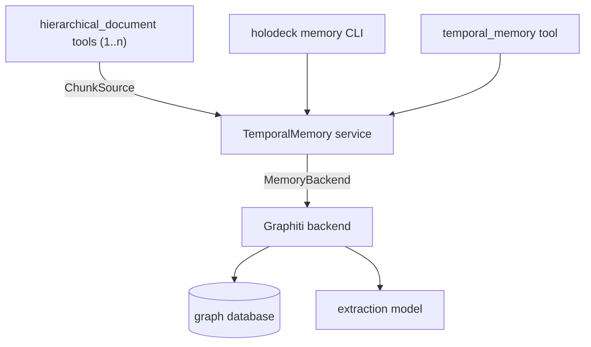
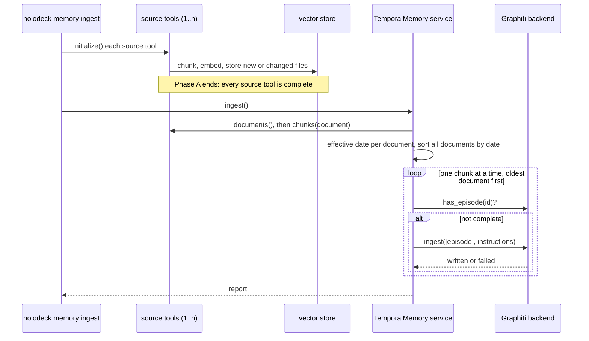
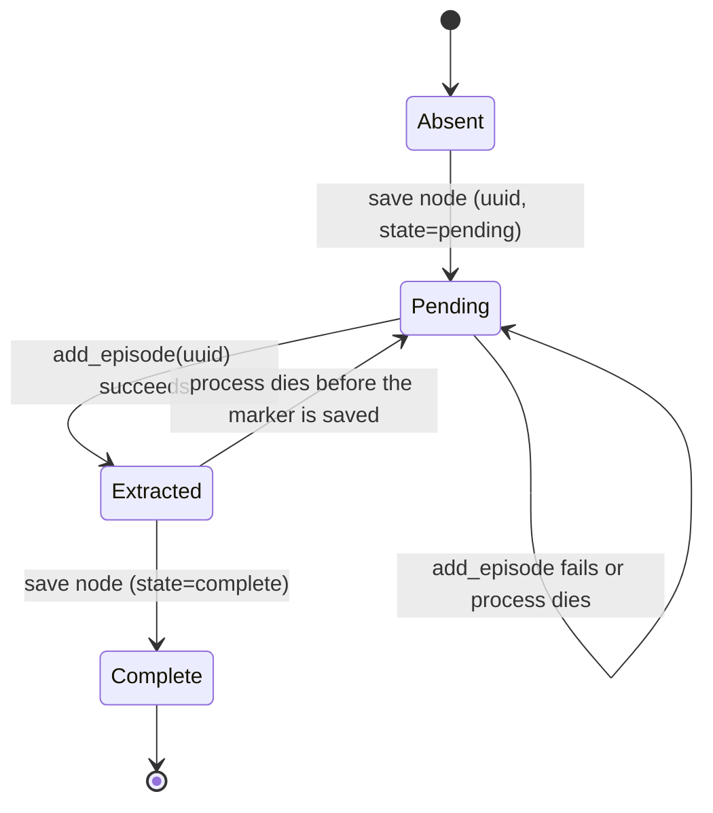
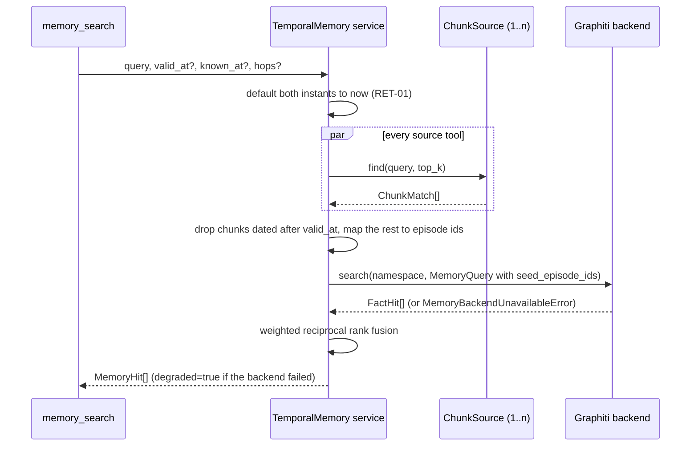
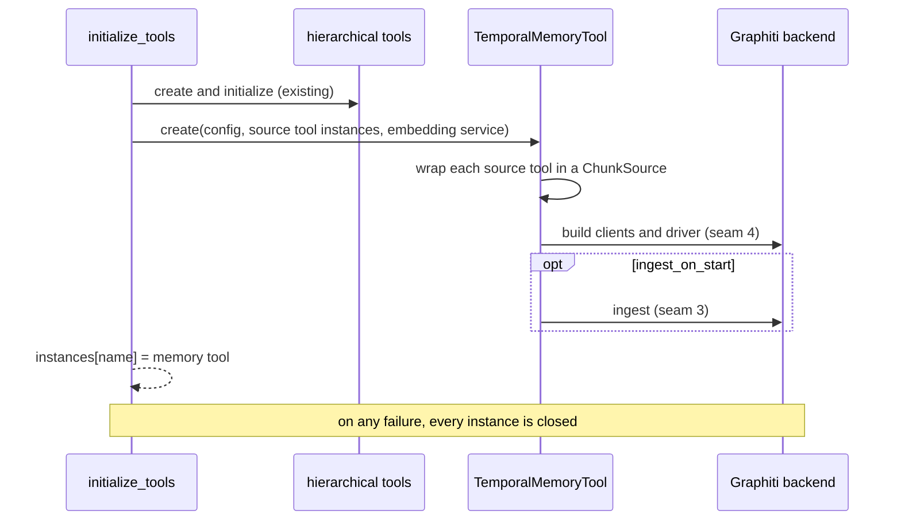

# Temporal memory: design

How the parts of [spec 043](../../product-specs/043-temporal-memory/spec.md) fit together, seam by seam. The spec says what the feature must do. This document says where the boundaries are and why. Measured Graphiti behaviour is in the [evidence file](graphiti-evidence.md).

**Status:** sections 1 to 3 are written. Section 2 was accepted by the maintainer on 2026-11-11. Section 3 is proposed and waits for review before T7. Sections 4 to 6 are not written yet.

| # | Seam | State | Built in |
| --- | --- | --- | --- |
| 1 | `MemoryBackend` port | Built | T2 |
| 2 | `ChunkSource`: hierarchical tool to memory | Accepted | T5 |
| 3 | Episode lifecycle in the Graphiti backend | Accepted | T7 |
| 4 | Model client selection | Accepted | T7, T23 |
| 5 | Search pipeline | Accepted | T11, T12 |
| 6 | Tool binding | Accepted | T13 to T15 |

## Overview



The service sits between two seams. On one side it reads chunks and chunk search results through `ChunkSource`. On the other it reads and writes facts through `MemoryBackend`. It holds the rules that belong to neither: episode identity, effective dates, ingestion order, and fusion.

## 1. The `MemoryBackend` port

**Purpose.** One contract for every fact store, so the service, the tool and the CLI do not know which store they use.

**Code.** `src/holodeck/lib/memory/ports.py`, `types.py`, `errors.py`; test double in `backends/fake.py`.

```python
class MemoryBackend(Protocol):
    name: str                                                  # property
    def capabilities() -> MemoryCapabilities
    async def has_episode(namespace, episode_id) -> bool
    async def episode_count(namespace) -> int
    async def ingest(namespace, episodes, instructions) -> IngestReport
    async def search(namespace, query) -> list[FactHit]
    async def timeline(namespace, entity_ref) -> list[TimelineEntry]
    async def provenance(namespace, fact_id) -> Provenance | None
    async def purge(namespace) -> None
    async def close() -> None
```

**Rules every backend follows.**

- Every call takes one namespace. A backend never reads or writes another.
- An operation the backend cannot do raises `MemoryNotSupportedError` before it touches the store.
- A store that cannot be reached raises `MemoryBackendUnavailableError`. The service then returns chunk-only results.
- `has_episode` is true only for a completed episode and makes no LLM call.
- `ingest` stops at the first failed episode and reports it. It does not raise for one bad episode.
- No backend client type appears in an argument or a return value. A test fails if any module other than the Graphiti one imports a graph client.

**Why the port is at this level.** The first design put the seam lower, at a `GraphStore` with operations such as "write edges" and "supersede". Graphiti's own pipeline does extraction and invalidation in one call, so it cannot sit behind that. The port is therefore at the level of "ingest episodes" and "search facts". The native backend planned for Phase 2 will implement this port with its own pipeline over a `GraphStore`.

**Known-at rule.** A fact is returned for valid time `V` and system time `K` when:

```text
recorded_at <= K
and valid_from <= V
and ( valid_to is unset
      or V < valid_to
      or the closing was recorded after K )
```

The last line matters on Graphiti, which keeps one edge per fact and stamps `expired_at` when a later fact closes it. Without that line, a question about the past asked today returns nothing.

## 2. `ChunkSource`: hierarchical tool to memory

**Purpose.** The memory needs two things from each source tool: every chunk, grouped by document, for ingestion; and ranked chunks for a query, for retrieval. `ChunkSource` is the read-only contract for both.

**Status.** Accepted 2026-11-11. This extends the surface of `HierarchicalDocumentTool`, which is an ask-first item.

### Contract

```python
@dataclass(frozen=True, slots=True)
class SourceDocument:
    source_tool: str
    source_uri: str          # stable key for the document
    path: Path               # local file, for front matter and mtime
    mtime_reliable: bool     # False for a downloaded remote source

@dataclass(frozen=True, slots=True)
class ChunkRef:
    source_tool: str
    chunk_id: str            # the id the tool's store uses
    source_uri: str
    section_id: str
    ordinal: int             # position in the document; UNKNOWN_ORDINAL (-1) on a search hit
    text: str                # chunk content, front matter removed

@dataclass(frozen=True, slots=True)
class ChunkMatch:
    chunk: ChunkRef
    score: float             # higher is better; order only

class ChunkSource(Protocol):
    name: str                                                   # property
    async def documents() -> Sequence[SourceDocument]
    async def document(source_uri: str) -> SourceDocument | None  # no store read
    async def chunks(document: SourceDocument) -> Sequence[ChunkRef]
    async def find(query: str, top_k: int) -> list[ChunkMatch]
```

### Where the code goes

```text
src/holodeck/lib/memory/
├── chunk_source.py        # the protocol and the three types (no tool import)
└── effective_date.py      # front matter, then mtime, then ingestion time
src/holodeck/tools/
├── hierarchical_document_tool.py   # one new read-only method: document_chunks()
└── hierarchical_chunk_source.py    # adapter: HierarchicalDocumentTool -> ChunkSource
```

The tool gains one method, `document_chunks()`, which returns every stored chunk grouped by source document. It cannot simply return the list the tool holds in memory: after a restart the tool skips unchanged files, and on a store with native hybrid search (Qdrant) it does not reload the corpus at all. As built in T5, the method always loads from the store, through the tool's existing `_load_chunks_from_store`. The tool keeps no record that it ingested everything in this process, and a repeated `initialize` appends to the in-memory list, so that list is never a safe source. Everything else is in the adapter. The memory library imports the protocol only, so `lib/` still does not depend on `tools/`.

### Ingestion, end to end

The source tool has no separate "ingest" step. Its `initialize()` is its ingestion: it discovers files, skips those already stored (by mtime for local files, by content hash for remote ones), and chunks, embeds and stores the rest. So the memory does not start vector ingestion with a special call; it initializes its source tools, and an empty store is filled as a result.



**Two phases, not interleaved.** Vector ingestion finishes for every source tool before the first graph episode is written. Inside the graph phase the work is chunk by chunk.

Why the phases are separate:

- **Order.** The graph needs one date order across all documents of all source tools, because a later fact closes an earlier one. The source tool processes files in discovery order, one tool at a time. That order is known only after every tool has finished.
- **Cost and failure.** Vector ingestion is cheap and batched. Graph ingestion is several LLM calls per chunk. A failed extraction must not leave a document half-embedded, and a graph run must be resumable without re-embedding.
- **Independence.** The source tool works without the memory. The seam is read-only, so the memory cannot change how or when the tool stores chunks.

With `ingest_on_start: true` the same two phases run at agent start: the tool initializer creates the source tools first, then the memory tool.

Initializing a source tool can itself cost LLM calls: when contextual embeddings are on, the tool makes one call per new chunk before any graph work starts.

`--dry-run` reads chunks through the tool's preview path (convert and chunk, no embedding and no store write) and asks the graph which episodes exist. It can do that because the episode id is a hash of the raw chunk text, which is the same before and after the chunk is stored. As built: `open_memory(preview_sources=True)` builds each source tool read-only and does not initialize it, and `HierarchicalChunkSource(preview=True)` lists chunks from `preview_document_chunks()`. A test holds the preview listing equal to the stored listing (source key, section id, ordinal and text), for local and remote sources. The preview counts the files on disk now; a remote source is downloaded to a temporary directory and removed afterwards.

Limits of the dry-run count (phase 2 review, second pass):

- It counts the files on disk, chunked with the current settings. A full run reads the vector store, so the two differ when the store holds chunks the files no longer produce: a deleted or emptied file whose records are still stored (the full run submits them, the dry run does not), and a chunking-setting change on unchanged files (the tool skips unchanged files, so the full run keeps the old chunks while the dry run counts the new ones).
- "No graph write" means no episode, entity or fact. The Kuzu driver creates its tables when it opens a database, and the FalkorDB driver schedules index creation when it is cloned for a namespace. Both happen on the read path too. Read from Graphiti's source; neither driver has been run.

### How ingestion uses it

```text
for each source tool
  for each document in source.documents()
    date, date_source = effective_date(document, key)
order all documents from all tools by date; on a tie, by position in source_tools
for each document, oldest first
  for each chunk in source.chunks(document), by ordinal
    episode_id = episode_id_for(namespace, chunk.section_id, chunk.text)
    make EpisodeIn(episode_id, chunk, date, date_source)
```

### How retrieval uses it

```text
for each source tool
  matches = source.find(query, top_k)
for each match
  episode_id = episode_id_for(namespace, match.chunk.section_id, match.chunk.text)
```

A search hit carries its section id and text, so the episode id is recomputed from the hit. No lookup table from chunk id to episode id is kept.

**Why retrieval passes seed episodes.** The backend can search facts in two ways. By text, it finds facts whose wording is close to the query. By expansion, it starts from entities and follows their edges, and finds facts that are connected to the topic even when their wording has nothing in common with the query. Expansion needs a starting point. The chunk retriever has already judged which passages are relevant, so the entities those passages mention are the starting point.

| Mode | Finds | Misses |
| --- | --- | --- |
| By text | Facts whose wording is close to the query | Related facts worded differently |
| By expansion | Facts connected to an entity, whatever their wording | Needs a starting entity |

The service cannot name those entities, because entities exist only inside the backend. The one key both sides share is the episode id. So the service passes episode ids, and the backend turns them into entities and expands from there. Seeds are optional: with none, the backend searches by text only.

Example: the question is "who administers the payment whose base rate changed in 2022?". Chunk search finds the passage about the rate. That passage's episode mentions the entity "Family Tax Benefit Part A". One hop from that entity is the fact "administered by Services Australia", which came from a different document and contains none of the words "base rate" or "2022".

Graphiti expands along outgoing edges only (decision D23), so a seed entity that is only ever the target of facts finds nothing. Seeding from every entity a passage mentions reduces that loss, because most facts have both ends mentioned in the same passage. If a hit's chunk has no episode yet, it adds no seed and the hit is still returned as a chunk.

### Decisions in this seam

| Question | Proposed | Reason |
| --- | --- | --- |
| Adapter, or make the tool implement the protocol? | Adapter plus one accessor on the tool | The tool's public surface grows by one read-only method. The mapping logic can change without touching a 1,400-line class. |
| Heading-only chunks | Left out | A heading has no fact to extract, and each episode costs several LLM calls. `preview_chunks` already leaves them out. |
| Front matter in the first chunk | The adapter removes it from `ChunkRef.text` | Otherwise the date line is extracted as a fact, and editing a date changes the episode hash. The chunker and the stored chunks do not change (spec assumption A6). The same function is applied to search hits, so ids still match. |
| Which text is hashed and extracted | The raw chunk content | The contextual-embedding text depends on the context model. Raw content keeps the hash stable when that model changes. |
| Remote sources | `mtime_reliable = False`; the date falls to front matter, then ingestion time | A downloaded file's mtime is the download time. The tool already avoids mtime for remote sources. |
| A chunk that is only front matter | Left out of `chunks()` | The chunker makes front matter its own chunk when a heading follows. After stripping, its text is empty. |
| Front matter in any chunk, not only the first | Stripped when the text starts with a `---` block that parses to a YAML mapping | A search hit does not carry its position, and both paths must give the same text |
| Ordinal of a search hit | `UNKNOWN_ORDINAL` | The tool's search result has no position. Looking it up would load the whole corpus on every query, and retrieval does not use it. |
| Chunk ids rewritten to UUIDs for Qdrant | `chunk_id` is whatever the store holds | Episode identity does not use the chunk id, so the rewrite has no effect on skipping. |

### What it does not do

- It does not trigger ingestion in the source tool. The source tool must be initialized first; the memory tool is created after its source tools.
- It does not expose embeddings, the keyword index, or the vector store.
- It does not change search behaviour. `find` calls the tool's existing `search`.

### Risks

- The tool's store loader logs a store error and returns nothing. To the memory that looks like a source with no documents. T6 must treat an initialized source tool with zero documents as an error, not as "nothing to ingest".
- A chunk that the tool splits differently after a chunking-setting change gets a new hash and is extracted again. This happens only when the tool re-ingests the file (the file changed, or ingestion is forced); an unchanged file keeps its stored chunks. `--dry-run` counts with the new settings, so it can overstate the count for unchanged files.
- Two tools that index the same file produce the same episode once (spec assumption A8). The fact then cites one tool only.

## 3. Episode lifecycle in the Graphiti backend

**Purpose.** Turn one `EpisodeIn` into one Graphiti episode exactly once, under a uuid the service chose, and survive a crash at any point.

**Status.** Accepted 2026-11-11. Built in T7. Items marked "verify in T7" were read from the Graphiti 0.31.2 source and not yet observed.

### What Graphiti gives us

Measured in T1 or read from the installed source:

- `add_episode(uuid=U)` loads an existing episode node and processes it. It raises `NodeNotFoundError` when U is absent. It cannot create an episode under a chosen uuid.
- Running `add_episode` again on the same uuid costs 2 to 3 LLM calls, ignores a changed body, and adds a duplicate mention edge each time. It adds no duplicate entity or fact.
- An episode node stores exactly nine fields: `uuid`, `name`, `group_id`, `source`, `source_description`, `content`, `valid_at`, `created_at`, `entity_edges`. The save query replaces the whole property set on Neo4j, FalkorDB and Neptune, so a custom property would be erased on the next save.
- The model also declares `episode_metadata`. Nothing in the library writes or reads it. It must not be used.
- `source_description` is put into the extraction prompt.
- With no `previous_episode_uuids`, `add_episode` uses the last 3 episodes in the group whose time is at or before the reference time as context for extraction.

### States



"Extracted" is not stored. It is the short interval between a successful `add_episode` and the save of the marker. On disk an episode is absent, pending or complete.

```text
ingest_one(episode)
  node = get episode by uuid                     # no LLM call
  if node is absent
    save node(uuid, state=pending, fields below)
  else if node.state is complete
    return skipped                               # the service normally filters these out first
  if node exists with another name or body
    return failed                                # not written by this backend
  add_episode(uuid, previous_episode_uuids, instructions, entity_types)
  set state=complete where the node still exists # a conditional update, never a save
```

The last step is one update query that matches the node by uuid and namespace. It cannot create a node. If a purge removed the episode during extraction, the update matches nothing and the episode is reported as failed, so an episode is never complete without its facts. `previous_episode_uuids` holds only the context episodes that exist in the same namespace.

`has_episode` is true only for the complete state. Complete is decided by the name prefix `hd1:complete:` alone, which is also what the count query matches.

### Where each value is stored

The state and the HoloDeck fields must live in fields Graphiti persists. A custom property would be erased, and `episode_metadata` is not stored.

| Graphiti field | Holds | Reason |
| --- | --- | --- |
| `uuid` | The content-hash episode id | The key for skipping |
| `group_id` | The namespace | Graphiti's own scoping |
| `valid_at` | The document's effective date | Becomes the reference time for extraction |
| `content` | The chunk text, front matter removed | What is extracted |
| `source` | `text` | Not a chat message and not JSON |
| `source_description` | A plain sentence: source URI, section, effective date | It goes into the extraction prompt, where the date and section help the model |
| `name` | `hd1:<state>:<json>` with source tool, chunk id, source URI and date source | The only free field left; the prefix lets a count query filter on state |

Provenance reads the HoloDeck fields back from `name`. They are never parsed from the sentence in `source_description`.

### Failure handling

| Failure | State left | Next run | Cost |
| --- | --- | --- | --- |
| Process dies after the pending node is saved | Pending, no facts | Processes the episode | None extra |
| `add_episode` raises (model error, timeout) | Pending | Reported as failed; the run stops (ING-05); processed on the next run | The failed calls |
| Process dies after extraction, before the marker | Pending, facts written | Processes it again | 2 to 3 LLM calls and one duplicate mention edge; no duplicate fact |
| Marker save fails | Pending, facts written | Same as above | Same as above |

The design accepts a small repeated cost in the rare crash cases so that it never marks an episode complete that was not extracted. The opposite error would silently lose facts.

### Context for extraction

The service knows the document order of chunks. Graphiti's default context is "the last 3 episodes by time", and all chunks of one document share one time, so the default would pick neighbours arbitrarily and could return the pending node of the episode being processed. The backend instead passes `previous_episode_uuids` explicitly: the two preceding chunks of the same document.

This needs one new field on `EpisodeIn`, which is now in `types.py`. An episode that lists itself as context is rejected.

```diff
 class EpisodeIn:
     episode_id: UUID
     ...
     reference_time_source: ReferenceTimeSource
+    context_episode_ids: tuple[UUID, ...] = ()    # preceding chunks of the same document
```

### Closing a superseded fact

Graphiti closes an old fact in two steps. One model call (`dedupe_edges.resolve_edge`) names the existing facts that a new fact contradicts. Plain code then sets each contradicted older fact's end date to the new fact's start date. That code needs a start date on both facts and the older one to start strictly earlier. A contradicted fact with no start date, or with the same start date, stays open.

Graphiti's own prompt for that call is written for conversations: it forbids inferring a replacement from dates and wants explicit replacement wording. A dated provision replaces the earlier value without saying so, and the live fixture left superseded rates open (see [graphiti-evidence.md](graphiti-evidence.md), supersession probe).

`build_graphiti` therefore passes a prompt library (`create_prompt_library`, a supported Graphiti argument) that replaces that one prompt with `backends/graphiti_prompts.py`. The rule is: two facts that state different values of the same single-valued attribute (a rate, amount, percentage, threshold, limit or period) of the same subject contradict each other. A role or power contradicts an earlier holder only when it has one holder by its nature or the text says the earlier holder stopped. Inputs, output fields and duplicate rules are Graphiti's.

- The extraction instructions do not reach this call, so they cannot change the decision.
- The prompt is a copy to keep in step with Graphiti. A unit test pins the hash of Graphiti's own prompt, so an upgrade that changes it fails the test and forces a review.
- The decision is still a model decision. The risk in the other direction, closing a fact that should stay open (two categories of one rate), is not measured yet. T16 covers both directions.
- The override is always on. A YAML switch is not added until a corpus needs Graphiti's default.

### Decisions in this seam

| Question | Decision | Reason |
| --- | --- | --- |
| Where the completion marker lives | In `name`, with a versioned prefix | Uses only Graphiti's own save and load, so it works on every driver |
| What `source_description` holds | A readable sentence, not JSON | It is shown to the extraction model |
| Extraction context | The two preceding chunks of the same document | Deterministic and relevant; avoids self-reference |
| One `add_episode` per episode, in sequence | Yes, no bulk call | `add_episode_bulk` has no `uuid` argument, so it cannot use the content-hash id; and the order of episodes decides which fact closes which |
| Two ingest runs on one namespace at once | Not prevented in the MVP | Both would process the same pending episodes: wasted calls and duplicate mention edges, no wrong facts. Documented as a limit. |
| Counting episodes | One count query filtered on the `name` prefix | Loading every episode node would also load every chunk's text |

### Verified in T7

Observed on Neo4j 5.26 with a stub LLM client and a stub embedder (no model call):

| Question | Observed |
| --- | --- |
| Does `add_episode` keep `name` and `source_description` on a pre-saved node? | Yes. `content` is kept too, and `entity_edges` is filled. |
| Does a failed `add_episode` leave partial data? | No. Graphiti writes everything in one transaction at the end. An exception injected inside it left only the pending episode node; a retry wrote normally. |
| Is `name` in a full-text index? | No. The episode index covers `content`, `source`, `source_description` and `group_id`. |
| Does the count query run? | Yes, on Neo4j: 0 for a pending-only group, 2 after two episodes. |
| How is a namespace cleared? | Graphiti's `clear_data` with that one group. Two other groups were unchanged. |
| Re-run | 2 episodes cost 5 stub LLM calls; the second run wrote 0 with 0 calls. |

So on Neo4j the "pending, facts written" state happens only when the process dies between a successful `add_episode` and the marker save.

Not observed: FalkorDB, Neptune and Kuzu, whose packages are not installed. On FalkorDB, Graphiti keeps one graph per group, so the backend does its own reads and writes on the driver Graphiti clones for the namespace. That path is covered by unit tests with Graphiti mocked only.

## 4. Model client selection

**Purpose.** Build the three client objects Graphiti needs (LLM, embedder, cross-encoder) from HoloDeck configuration, so that every model call goes to an endpoint the agent YAML names.

**Status.** Accepted 2026-11-11. Built in T7 (factory, embedder, the four API clients) and T23 (Agent SDK client). Items under "Verify" were read from installed source and not yet observed.

### What Graphiti gives us

Read from the 0.31.2 source, or measured in T1 where stated:

- Each client argument has a default that calls OpenAI. `llm_client=None` builds `OpenAIClient()`, `embedder=None` builds `OpenAIEmbedder()`, `cross_encoder=None` builds `OpenAIRerankerClient()`. T1 measured that construction with no cross-encoder and no `OPENAI_API_KEY` raises `OpenAIError`.
- Graphiti asks for two model sizes. Seven call sites ask for the small model (deduplication and edge resolution). The OpenAI clients use a built-in model name when `small_model` is not set.
- Each LLM client gets structured output in a different way:

  | Graphiti client | How it gets a schema-valid reply |
  | --- | --- |
  | `OpenAIClient` | Responses API, `responses.parse` |
  | `AzureOpenAILLMClient` | `responses.parse` for reasoning models, `beta.chat.completions.parse` for the others. Accepts an `AsyncOpenAI` client on Azure's `/openai/v1` endpoint. |
  | `OpenAIGenericClient` | Chat completions with a `json_schema` response format, not strict. Can be set to `json_object`, which puts the schema in the prompt. |
  | `AnthropicClient` | One forced tool call whose input schema is the reply model. Accepts a ready `AsyncAnthropic` client. |

- Every LLM client records input and output tokens per call in a token tracker, and Graphiti exposes the totals.
- The base client retries server errors. Each client also retries a reply that fails validation, two more times.
- A client built with `cache=True` writes prompts and replies to `./llm_cache` on disk. Prompts contain document text.
- An embedder has two methods: `create` returns one vector, `create_batch` returns one per input.
- Graphiti runs up to 20 model calls at once inside one episode (`max_coroutines`).
- The installed `openai` 3.48.0 client has `responses.parse`, `beta.chat.completions.parse` and `chat.completions.create`. This was an attribute check. No call was made.

### Selection

`extraction_model` is a HoloDeck `LLMProvider`, the same model that agents and `context_model` use. Selection is a function of two of its fields and reads no environment variable.

| `provider` | `auth_provider` | LLM client | Endpoint |
| --- | --- | --- | --- |
| `openai` | not used | Graphiti `OpenAIClient` | `endpoint`, else `https://api.openai.com/v1`, always passed explicitly |
| `azure_openai` | not used | Graphiti `AzureOpenAILLMClient` with an `AsyncOpenAI` client | `<endpoint>/openai/v1`, the same URL rule the embedding path uses |
| `ollama` | not used | Graphiti `OpenAIGenericClient` | `<endpoint>/v1` |
| `anthropic` | `api_key` or not set | Graphiti `AnthropicClient` | `endpoint`, else `https://api.anthropic.com`, always passed explicitly |
| `anthropic` | `oauth_token` | HoloDeck `AgentSdkLLMClient` | The Claude Code CLI. Loading fails when `ANTHROPIC_API_KEY`, `ANTHROPIC_AUTH_TOKEN`, `ANTHROPIC_BASE_URL` or a `CLAUDE_CODE_USE_*` variable is set, because the CLI would then use another provider, endpoint or credential. |
| `anthropic` | `bedrock`, `vertex`, `foundry`, `custom` | None. Loading fails with `MemoryConfigError`. | — |

```text
build_clients(extraction_model, embedding_service)
  set GRAPHITI_TELEMETRY_ENABLED=false           # before any Graphiti object exists
  credential = validate_credentials(extraction_model)   # existing HoloDeck check; names the missing variable
  llm = client for (provider, auth_provider)     # table above; unknown pair raises MemoryConfigError
  embedder = LiteLLMEmbedder(embedding_service)
  cross_encoder = RefusingCrossEncoder()
  return llm, embedder, cross_encoder
```

**This changed D24 and GPH-04.** They said the Anthropic client is chosen by which environment variable is set. The client is now chosen by `auth_provider`, for three reasons. HoloDeck already has the field and `validate_credentials` already maps it to the variable it needs. A machine with both variables set would otherwise change billing path with no change to the YAML. And the YAML then states where document text is sent, which is what the spec boundary requires.

### Settings passed to the LLM client

| Setting | Value | Reason |
| --- | --- | --- |
| `model` | `extraction_model.name` | |
| `small_model` | The same name | Decision: one extraction model. If it is not set, the OpenAI clients call a built-in model name that the YAML does not contain. |
| `temperature` | `extraction_model.temperature` | The HoloDeck default is 0.3. Graphiti omits it for reasoning models. |
| `max_tokens` | `extraction_model.max_tokens` only when the YAML sets it; otherwise Graphiti's 16384 | The HoloDeck default is 1000, which would cut extraction JSON short. Pydantic's `model_fields_set` tells a set value from a default. |
| `api_key` | Unwrapped from `SecretStr` at the call | Never logged, never put in an error message. Error text and Graphiti's own log records are redacted for every credential the clients can use: the YAML value, the environment variable, the database password and a password inside the URI. |
| `cache` | `False` | The cache writes document text to the working directory |
| `max_coroutines` | Graphiti's default for the API clients; 4 for the Agent SDK client | Each Agent SDK call starts a CLI process. 4 is a starting value, to be measured in T23. |

### Embedder

One adapter, `LiteLLMEmbedder`, wraps the `LiteLLMEmbeddingService` that `create_embedding_service(agent, dimensions)` returns. The source tools get their service from the same function.

```text
LiteLLMEmbedder(EmbedderClient)
  create(input)        -> first vector of service.generate_embeddings([text])
  create_batch(texts)  -> service.generate_embeddings(texts)
```

- No Graphiti embedder class is used. OpenAI, Azure OpenAI and Ollama embeddings all work through HoloDeck's existing provider mapping.
- Graph vectors and chunk vectors come from the same model and dimension. CFG-06 makes this well defined: source tools that differ in embedding model or dimension fail at load.
- Graphiti calls `create` with a string or a list holding one string. The adapter accepts both and raises `TypeError` for token-id input, which Graphiti does not send.

### Cross-encoder

The backend always passes `RefusingCrossEncoder`. Its `rank` raises `TemporalMemoryError`. Graphiti therefore never builds `OpenAIRerankerClient`, and a search recipe that needs a reranker fails loudly instead of sending passages to OpenAI. The recipes are in seam 5.

### Agent SDK client (T23)

```text
_generate_response(messages, response_model, max_tokens, model_size)
  system = system messages, joined
  user   = the other messages, joined
  options = ClaudeAgentOptions(model, system_prompt=system, tools=[], max_turns=2,
                               setting_sources=[], strict_mcp_config=True,
                               output_format=schema of response_model)
  repeat up to 3 times
    reply = query(user, options)
    if reply is an error result: raise
    if reply validates against response_model
      record tokens from the result message
      return it as a dict
    add the validation error to user
  raise
```

Differences from the T1 script, which measured 31 calls with no schema failure:

| T1 script | T23 client | Reason |
| --- | --- | --- |
| `permission_mode="bypassPermissions"` | Default permission mode | With `tools=[]` there is nothing to permit. T23 records the reason if the default mode blocks. |
| Reply parsed from text, fences removed | `output_format` with the reply schema, then validation | The SDK option exists in 0.2.179 and HoloDeck's Claude backend already uses it. The T1 text path stays as the fallback. |
| Class-name checks and `cast(Any, ...)` | `isinstance` on the SDK message types | Repository rule: no `Any` to bypass known types |
| No token count | Tokens from the result message go to the token tracker | `IngestReport` reports them |

`setting_sources=[]` stays. It stops the CLI from loading the user's `CLAUDE.md`, hooks and MCP servers into an extraction call. T23 added `strict_mcp_config=True` for MCP servers from global configuration.

As built, `max_turns` is 2. The CLI implements structured output as an internal tool whose input it checks against the schema. A valid reply ends in one turn; the second turn lets the CLI send a rejected reply back to the model once. The Checkpoint C live run confirmed it: a successful call reported two turns, so 2 is the minimum that works.

### Where the code goes

```text
src/holodeck/lib/memory/backends/
├── graphiti.py             # the backend; asks graphiti_clients for its three clients
├── graphiti_clients.py     # build_clients, LiteLLMEmbedder, RefusingCrossEncoder (T7)
└── graphiti_agent_sdk.py   # AgentSdkLLMClient (T23)
```

All three names start with `graphiti`, so the existing import guard (MB-01) lets them import `graphiti_core` and keeps every other memory module free of it.

### Decisions in this seam

| Question | Decision | Reason |
| --- | --- | --- |
| What selects the Anthropic client | `auth_provider` in YAML, not the environment | Declarative; reuses `validate_credentials`; no silent change of billing path |
| `bedrock`, `vertex`, `foundry`, `custom` | Refused at load in the MVP | None was measured. A later change may route them to the Agent SDK client, because the CLI supports them. That needs one measured run per provider first. |
| LLM clients for the API providers | Graphiti's own four | Each uses its provider's native structured output |
| One LiteLLM-based LLM client for every provider | Rejected for now | One class instead of four, but it gives up native structured output, and extraction quality is the risk this feature carries |
| Embedder | One adapter over `LiteLLMEmbeddingService` | Same vectors as the chunks; no second provider mapping |
| Small model | Same as the extraction model | Earlier decision; also keeps every call on a model the YAML names |
| HoloDeck `max_tokens` default | Not passed | 1000 tokens is too few for extraction output |

### Verify

In T7:

- One real call through each of `OpenAIClient` and `AzureOpenAILLMClient` on `openai` 3.48.0. T0 proved import only.
- `OpenAIGenericClient` against Ollama's `/v1` endpoint returns schema-valid output in `json_schema` mode. If not, use `json_object`.
- `AnthropicClient` with a model name that is not in its token-limit table does not send a `max_tokens` the model rejects.
- A unit test fails if `Graphiti` is ever built with a `None` client.

In T23:

- `output_format` returns a reply within `max_turns=1`. If the SDK needs a second turn for structured output, raise the limit or use the text path.
- The default permission mode with `tools=[]` runs with no prompt.
- Where the result message carries token counts.

### Risks

- Four Graphiti clients mean four behaviours. A provider can pass unit tests with Graphiti mocked and fail live. T10 runs one provider in CI; the others are checked by hand at Checkpoint C.
- The existing `ClaudeSDKContextGenerator` uses `bypassPermissions` and loads user settings. It is outside this feature. It is a candidate for the technical debt tracker.

## 5. Search pipeline

**Purpose.** Answer one `memory_search` call: find chunks, find facts that were valid at one date and known at another, and return one ranked list.

**Status.** Accepted 2026-11-11. Built in T11 (backend read side) and T12 (service search and fusion). The known-at rule and the two-query plan are reasoned from T1's measured timestamps and from the 0.31.2 source. Neither has run against Graphiti.

### What Graphiti gives us

Measured in T1, or read from source where stated:

- `search_` takes a search configuration, `group_ids`, `bfs_origin_node_uuids` and a `SearchFilters` object. It returns edges and one score per edge.
- An edge configuration lists the methods to run (full-text, vector similarity, breadth-first) and one reranker. Reciprocal rank fusion needs no model call. Each method fetches `2 × limit` candidates (source).
- `bfs_max_depth` can be 1 or 2. The traversal follows outgoing edges only (D23). It returns closed facts unless a time filter is passed.
- When breadth-first search is listed and no origin is given, Graphiti runs it a second time from the source nodes of the first results (source).
- `SearchFilters` has one filter per date field. Inside a field, groups are joined by OR. **Fields are joined by AND** (source). A condition of the form "field A passes OR field B passes" cannot be written.
- A dated comparison never matches a null value. Each one needs an explicit `IS NULL` group. Two dated groups on one field collide on a parameter name, so a field can have at most one.
- `get_nodes_and_edges_by_episode` returns the entities an episode mentions. An edge's `episodes` list names the episodes that produced it.
- The recipe objects are shared at module level, and `search()` changes them. The backend builds its own configuration.
- Graphiti does not record which edge closed which.

### The whole call



### Inside the backend

```text
search(namespace, query)
  seeds = entity uuids mentioned by query.seed_episode_ids        # one lookup, no model call
  config = edge search: full-text + similarity + breadth-first, RRF, bfs_max_depth = query.hops
  open   = search_(query.text, config, group, seeds, filter OPEN)
  if query.known_at is before now
    closed_later = search_(query.text, config, group, seeds, filter CLOSED_LATER)
  edges = open + closed_later, one per uuid, best score kept
  load the episodes the edges name                                # one lookup
  return edges as FactHit, best first, at most query.limit
```

Seeds are entity uuids, so a hop is one entity-to-entity edge (RET-04, RET-09). With no seeds, Graphiti still expands from its own first results.

### The known-at rule

A fact is returned for valid time V and known time K when all three hold:

1. The store had recorded it: `created_at <= K`.
2. It had started: `valid_at <= V`, or `valid_at` is null.
3. As the store believed at K, it had not ended at V: `invalid_at` is null, or `invalid_at > V`, or `expired_at > K`.

The third alternative in rule 3 is the reason for this section. Graphiti keeps one edge per fact. When a newer fact closes it, Graphiti sets `invalid_at` and stamps `expired_at` with the wall-clock time. So `expired_at > K` means "at K, nobody had closed this yet". At K the store believed the fact was open.

Rule 3 joins two fields by OR, which `SearchFilters` cannot express. The backend therefore runs two filters and merges:

| Filter | `created_at` | `valid_at` | `invalid_at` | `expired_at` |
| --- | --- | --- | --- | --- |
| OPEN | `<= K` | null, or `<= V` | null, or `> V` | — |
| CLOSED_LATER | `<= K` | null, or `<= V` | — | `> K` |

Each field has at most one dated group and one `IS NULL` group, which stays clear of the parameter defect.

Worked example, with T1's fixture: the 100-dollar rate from 2020, closed by the 120-dollar rate dated 2022-07-01, which was ingested at time T2.

| Query | 100-dollar fact | 120-dollar fact |
| --- | --- | --- |
| V = 2021, K = now | OPEN matches (`invalid_at` 2022 > 2021) | Not started |
| V = 2023, K = now | No match (`invalid_at` <= V, `expired_at` <= now) | OPEN matches |
| V = 2023, K before T2 | CLOSED_LATER matches (`expired_at` = T2 > K) | Not recorded (`created_at` > K) |

In the third row the fact is returned as the store believed it at K: `valid_to` and `expired_at` are both set to none.

Both queries run for every K, the present included. An earlier version skipped the second query when K was within a minute of the backend's clock. The phase 3 review showed that this drops a fact the rule admits: ingestion can close a fact between the caller reading its clock and the search running, and a K a few seconds in the past is a real past. Every search therefore costs two Graphiti searches.

**Alternative rejected.** Run one query with rules 1 and 2 only, and apply rule 3 in Python. Graphiti cuts each method to `2 × limit` candidates before the backend sees them. In a namespace with a long history most candidates are closed facts, so correct facts would be cut before the filter ran.

### Mapping an edge to a fact

| `FactHit` field | From |
| --- | --- |
| `fact_id` | Edge uuid |
| `text` | Edge `fact` |
| `valid_from` | `valid_at` |
| `valid_to` | `invalid_at`, or none when `expired_at > K` |
| `recorded_at` | `created_at` |
| `expired_at` | `expired_at`, or none when it is after K |
| `score` | The reranker score for the edge |
| `sources` | The episodes the edge names, decoded from each episode's `name` (seam 3) |
| `superseded_by` | Always none on Graphiti. The timeline shows what came next. |

### Inside the service: fusion

Each source tool gives one ranked chunk list. The backend gives one ranked fact list. Scores from different lists are not comparable, so fusion uses rank only.

```text
score(chunk) = w_chunks / (60 + rank in its tool's list)
score(fact)  = w_graph  / (60 + rank in the fact list)
             + w_chunks / (60 + best rank of a chunk hit that is one of the fact's sources)   # if any
return the top_k hits by score; ties broken by kind, then id
```

A fact that the chunk search also supports gets both terms. That is the case reciprocal rank fusion exists for: two independent retrievers agree. A chunk gets no extra term, because the fact already carries the chunk's id and source.

### Chunk hits and time

Chunks have no valid period. The service knows one date for a chunk: the effective date of its document.

- A chunk whose document takes effect after V is dropped. It also gives no seed.
- Every other chunk is returned with `valid_from` set to that date and `valid_to` none.
- `known_at` does not apply to chunks. The index holds only what is in it today.
- The date is read from the source file on every search, through `ChunkSource.document(source_uri)`: one call per distinct document among the hits, no store listing and no cache. A date corrected on disk is seen by the next search. A missing file, a bad date in front matter, or a document dated only by ingestion time gives an undated chunk, which is kept. (Added after the phase 3 review, with the maintainer's approval of the new method. The first version listed every document in the store and cached the dates for the life of the service.)

So a chunk from a superseded compilation can still be returned for a query about today. Only fact hits carry an end date. The tool description in seam 6 must tell the agent this.

### Degraded results

| Failure | Result |
| --- | --- |
| The backend raises `MemoryBackendUnavailableError` | Chunk hits only, each with `degraded: true` (RET-07) |
| One source tool's search fails | The error is raised. A missing source is a configuration fault, not a degraded state. |
| Every source tool returns nothing | Fact hits from Graphiti's own search, with no seeds |

### Decisions in this seam

| Question | Decision | Reason |
| --- | --- | --- |
| How the known-at rule is applied | Two filtered Graphiti searches, merged | Exact. The second runs only for a past K. |
| Search methods | Full-text, similarity and breadth-first, fused by RRF | No model call and no cross-encoder |
| What the backend searches | Edges only | The tools return facts. Entity and community search add cost and no field of `MemoryHit`. |
| Fusion | Weighted RRF by rank, with a second term for a fact whose source chunk was also hit | Rewards agreement between the two retrievers |
| RRF constant | 60, not configurable | The usual value. The weights are the configured control. |
| Chunks dated after V | Dropped | A provision not yet in effect is a wrong answer for V |
| Chunks from superseded documents | Returned, with a start date only | The service cannot know a chunk's end date |
| `superseded_by` on Graphiti | None | Graphiti does not record it, and guessing would be wrong some of the time |

### Verify in T11

- The "between two compilations" case: V after the newer fact, K between the two ingests, returns the older fact as open. This is the third row of the worked example.
- `SearchFilters` joins fields by AND on Neo4j and FalkorDB.
- A null `valid_at` occurs in practice, and the null group returns it.
- The second breadth-first pass, with no seeds, respects the time filter.
- Edge scores from two `search_` calls are comparable enough to merge. If not, merge by rank.

### Risks

- A fact ingested out of date order has `created_at` and `expired_at` close together (T1, one run). Known-at queries on back-filled facts are not meaningful. ING-04 ingests in date order to avoid this.
- Outgoing-only expansion (D23) can miss a fact whose seed entity is the edge target. T17 measures it.
- The clock: the backend does not compare K with its own time. Both queries always run (see the known-at rule).

## 6. Tool binding

**Purpose.** Turn one `temporal_memory` entry in agent YAML into a running memory and three functions the agent can call, with the same names, arguments and results on both backends.

**Status.** Accepted 2026-11-11. Built in T13 (tool and Claude binding), T14 (OpenAI Agents binding and the contract test) and T15 (Temporal).

### What HoloDeck gives us

Read from the current code:

- `initialize_tools` creates one embedding service, then the vectorstore tools, then the hierarchical document tools. It returns instances keyed by tool name and closes them all if any step fails. Both backends call it.
- Each existing search tool gives the agent one function named `<tool name>_search` with one argument, `query`. The result is formatted text.
- The Claude side wraps each instance in an adapter with `to_sdk_tool()`, singular, and builds the allowed-tool list by adding `_search` to the name. The OpenAI Agents side builds one SDK function tool per instance and rejects name collisions through `sdk_tool_name_for`, which returns one name.
- A tool that is not initialized raises `BackendSessionError` when called.
- Temporal defines one activity per workflow node (`temporal/activity.py`).

The memory tool differs on every point: three functions, fixed names, several arguments, JSON results.

### Lifecycle



| Situation at start | Result |
| --- | --- |
| The graph database is down, `ingest_on_start: false` | The tool starts. A warning is logged. Searches return chunk hits with `degraded: true`. |
| The graph database is down, `ingest_on_start: true` | Start fails with `MemoryBackendUnavailableError`. The user asked for ingestion. |
| The `graphiti` extra is missing | Start fails with the install command (CFG-05) |

`close()` closes the backend. It does not close the source tools, which `close_tools` already closes.

### One handler layer, two thin bindings

```text
src/holodeck/lib/memory/
└── tool_api.py              # argument and result models, call(name, args) -> JSON text
src/holodeck/tools/
└── temporal_memory_tool.py  # lifecycle: sources, backend, ingest_on_start, close
src/holodeck/lib/backends/
├── tool_adapters.py                 # Claude: three SDK tools from one instance
└── openai_agents_tool_adapters.py   # OpenAI Agents: three function tools from one instance
schemas/memory/              # JSON schemas generated from the models in tool_api.py
```

```text
call(name, args)
  validate args with the model for `name`       # a bad argument becomes an error result
  run the service method
  return the result model as JSON text
```

Each binding does two things only: register the three names with their argument schemas, and pass the call through. The Claude binding wraps the JSON text in a text content block. The OpenAI Agents binding returns it as the function result. Neither one formats, validates or handles errors.

The schemas in `schemas/memory/` are generated from the Pydantic models, and a check fails when they drift, in the way `make schema-check` guards the agent schema.

### The three functions

| Function | Arguments | Result |
| --- | --- | --- |
| `memory_search` | `query`; optional `valid_at`, `known_at`, `hops` (1 or 2) | `{ valid_at, known_at, degraded, hits: MemoryHit[] }` |
| `memory_timeline` | `entity` | `{ entity, entries: TimelineEntry[] }` |
| `memory_provenance` | `fact_id` | `{ found, fact, sources[] }`, each source with its chunk text |

- **Fixed names.** The names carry no tool-name prefix (HST-01), which is why only one memory tool is allowed per agent (CFG-03). A function tool in the same agent with one of the three names fails at load.
- **Resolved instants are returned.** `memory_search` echoes the `valid_at` and `known_at` it used, so the agent can state the date its answer is for.
- **`top_k` is not an argument.** It comes from configuration.
- **Provenance returns the passage.** Each source gains `text`, read from the episode node the backend already loads. `EpisodeRef` has an optional `text` field for this, filled only by `provenance`.

### Dates in arguments

Models often send a date with no time. The handler accepts three forms and turns each into a UTC instant:

| Input | Read as |
| --- | --- |
| `2022-07-01` | 2022-07-01T00:00:00Z |
| `2022-07-01T09:30:00+10:00` | Converted to UTC |
| `2022-07-01T09:30:00` | Taken as UTC |

Front-matter effective dates go through the same function (`effective_date.py`). A provision dated 2022-07-01 and a query for 2022-07-01 therefore meet at the same instant, and the half-open period includes it.

Every timestamp in a result is ISO 8601 with a `Z` suffix (HST-02).

### Errors are results

An exception inside a tool call ends the agent's turn on some hosts. The model can recover from a result. So the handler returns:

```json
{ "error": { "code": "invalid_argument", "message": "valid_at must be an ISO 8601 date or datetime, for example 2022-07-01 or 2022-07-01T09:30:00Z" } }
```

| Cause | `code` |
| --- | --- |
| An argument fails validation | `invalid_argument` |
| The backend cannot do the operation | `not_supported`, with the operation name |
| The backend is down, for `memory_timeline` or `memory_provenance` | `backend_unavailable` |
| The backend is down, for `memory_search` | Not an error: chunk hits with `degraded: true` |
| An unknown `fact_id` | Not an error: `found: false` |

A message is fixed text for the field. It never repeats the argument value or an unknown field's name, because either can carry a secret or document text (phase 3 review). A store failure that is not "cannot be reached" is not a result: it raises, so a query error or a bug is not hidden as a degraded search.

A tool that was never initialized still raises `BackendSessionError`, as the other tools do. That is a host fault and not something the model can correct.

### What the agent is told

The function descriptions carry the rules that seam 5 leaves to the agent. Draft for `memory_search`:

> Search the knowledge base for facts and passages. Pass `valid_at` (a date) to ask what was true on that date; it defaults to today. A hit of kind `fact` has `valid_from` and `valid_to` and was true on `valid_at`. A hit of kind `chunk` is a source passage with a start date only, and it may come from a superseded version; prefer facts when they disagree. Use `memory_timeline` for the history of one entity and `memory_provenance` for the source of a fact.

The YAML `description` field is added in front of this text. It does not replace it.

### Temporal

- An agent node runs as one activity, so a memory function called by the agent already runs inside that activity. No memory code is imported by workflow code.
- Ingestion gets its own activity. It heartbeats after each episode. A retry is safe and cheap, because completed episodes are skipped by their content-hash id (seam 3).
- `ingest_on_start: true` under a worker runs ingestion inside the first agent activity that creates the tool. Its duration is unbounded, so the worker refuses that setting and names the ingestion activity and the CLI command.

### Decisions in this seam

| Question | Decision | Reason |
| --- | --- | --- |
| Where arguments are validated and results serialized | One module, `lib/memory/tool_api.py` | The two bindings cannot differ, and the contract test compares one thing |
| Result format | JSON object, not formatted text | HST-02; the agent needs the dates as fields |
| Error handling | Error results for causes the model can correct | Keeps the turn alive |
| Graph database down at start | Start, degraded, unless `ingest_on_start` | Matches RET-07 |
| Date-only arguments | Start of day, UTC, same parser as front matter | Query dates and effective dates must meet |
| Passage text in provenance | Yes, from the episode node | No vector-store lookup by id is needed |
| `ingest_on_start` under a Temporal worker | Refused | An activity of unbounded length |
| YAML `description` | Prefixed to the built-in text | The built-in text states rules the agent needs |

### Verify

- T13: the Claude allowed-tool list contains the three fixed names and no `<name>_search` entry for the memory tool.
- T14: `_reject_sdk_name_collisions` sees all three names.
- T14: the same call on both bindings returns byte-identical JSON text when it reaches the handler. Verified for 12 argument sets. One accepted difference (maintainer decision, phase 3 review): the Claude SDK validates arguments against the schema before the handler runs, so a schema-invalid call (`hops: 3`, an empty query, an unknown field) returns the SDK's `Input validation error` text with `isError` on Claude, and the `invalid_argument` result on OpenAI Agents. A bad date string passes the schema and gives the same result on both. A test goes through the real SDK dispatch to pin this down.
- T15: an agent node is one activity and tool calls run inside it. This was read from `temporal/activity.py` and not traced.

### Risks

- The fixed names break HoloDeck's `<tool>_search` convention. A second memory tool per agent would need prefixed names and a spec change.
- A result with ten hits and full passage text is large. `top_k` is the only control in the MVP.
