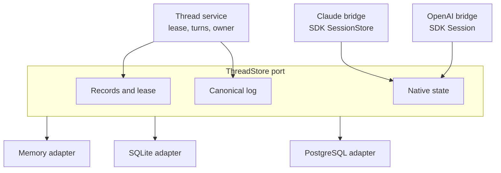
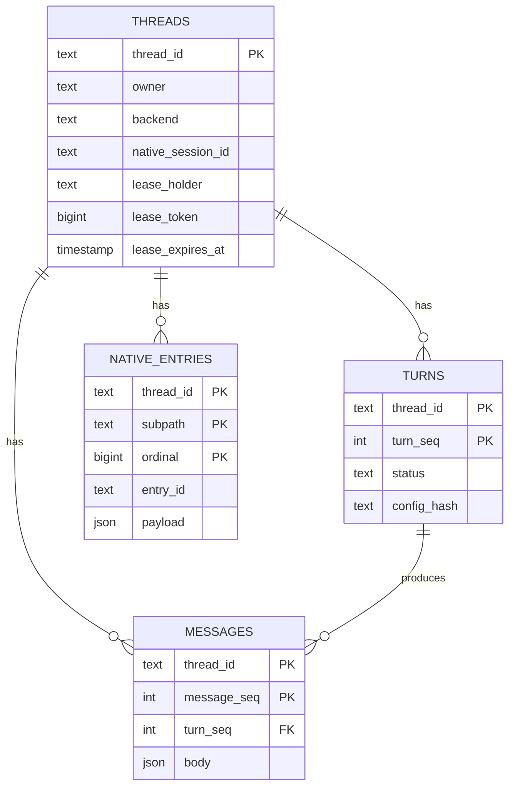
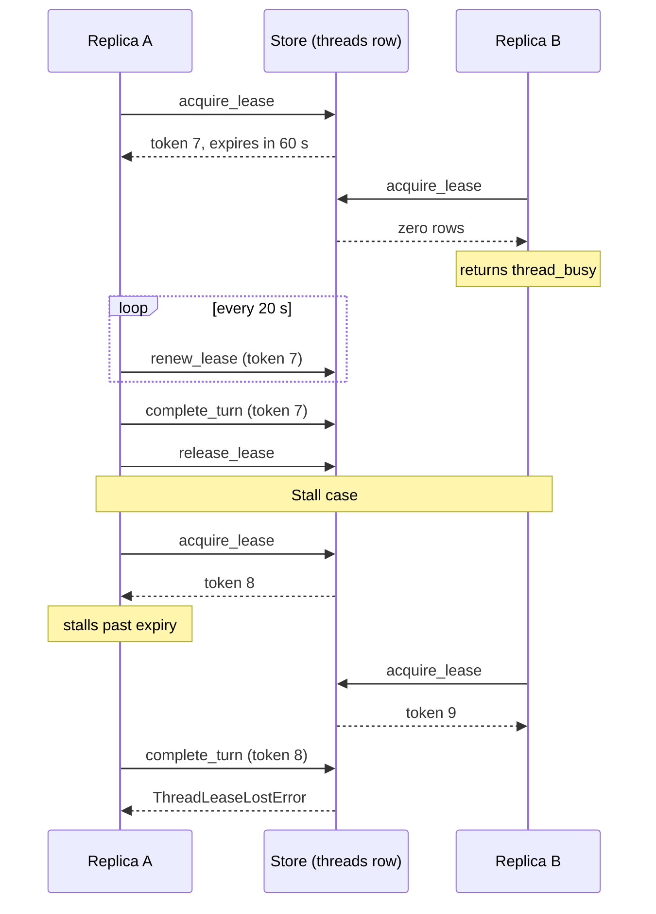
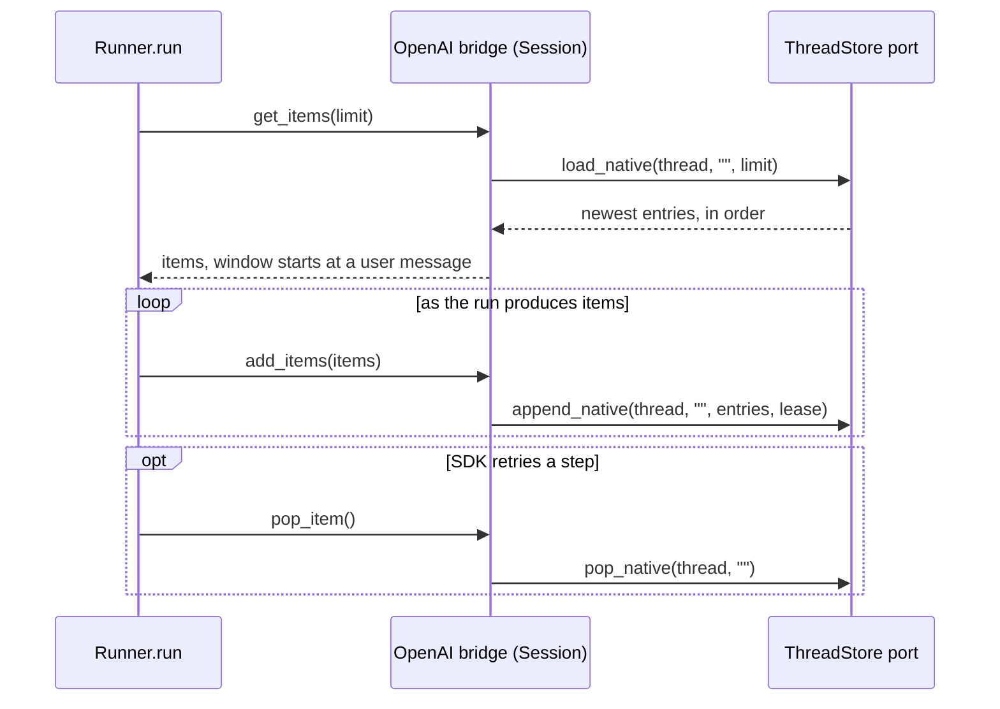
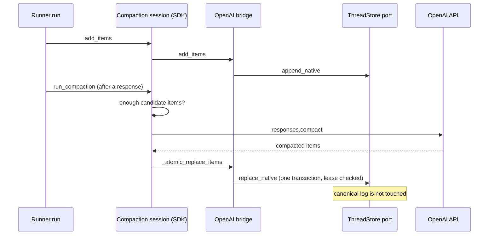
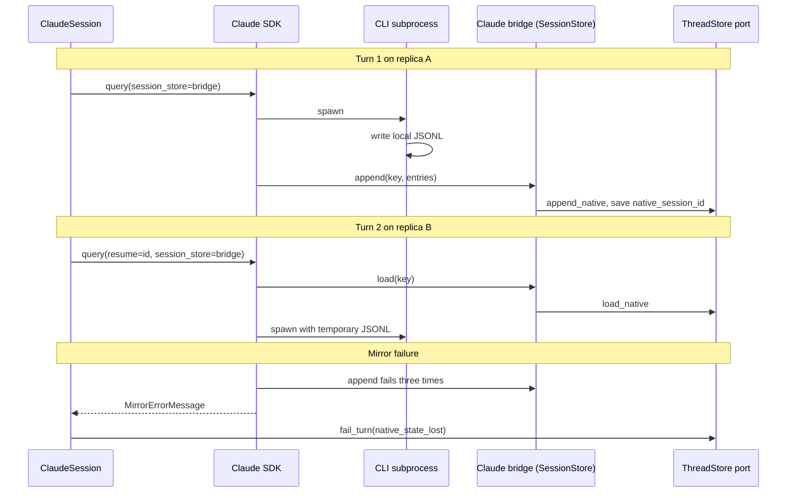
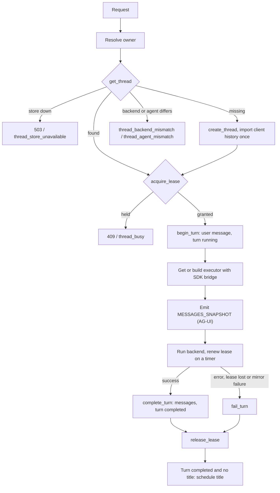
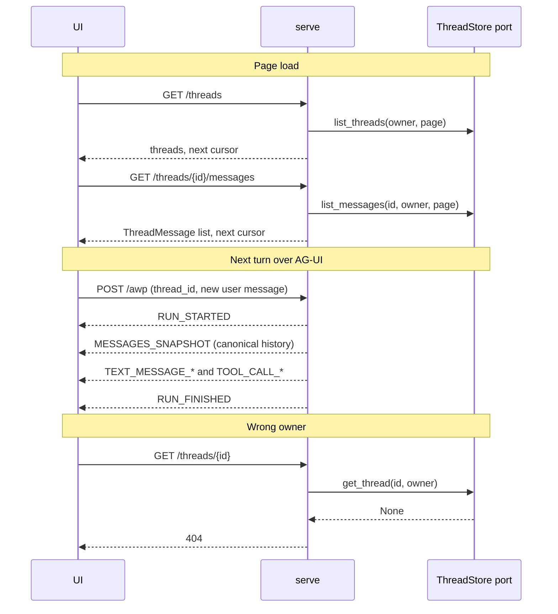
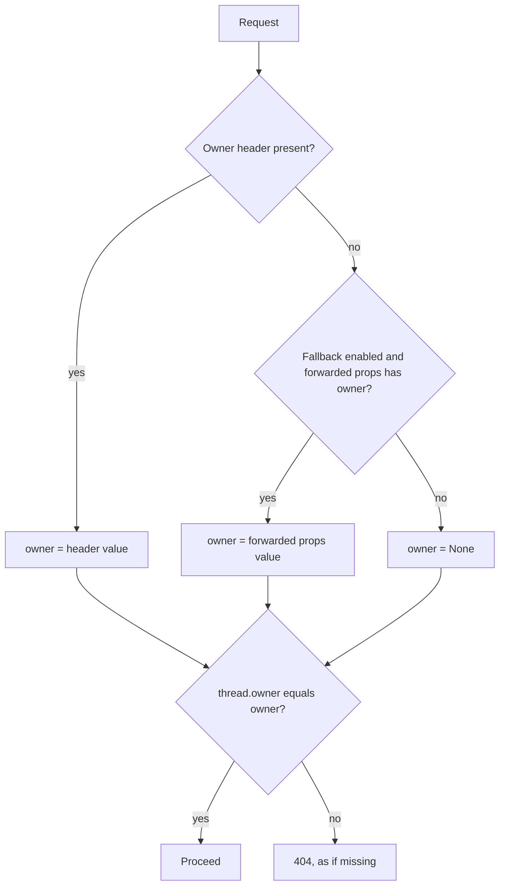
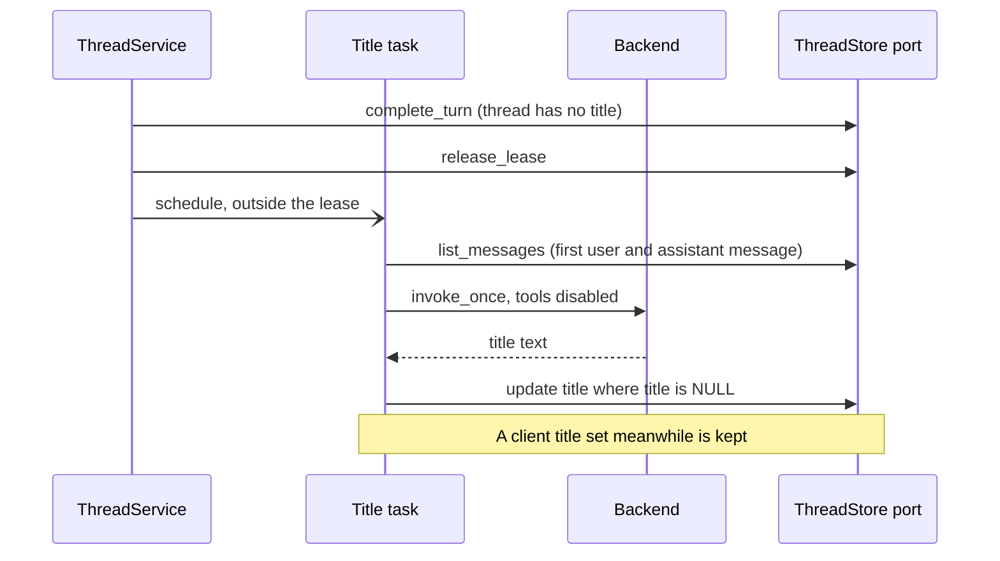

# Thread store: design

**Status:** Draft, 2026-11-15. Not built.
**Spec:** [045 thread store](../../product-specs/045-thread-store/spec.md). Decision numbers (D1 to D37), assumptions (A1 to A8) and requirement ids (TS, CFG, MIG) refer to that spec.
**SDK baseline:** `claude-agent-sdk` 0.2.179, `openai-agents` 0.24.0. Protocol facts below were read from the installed packages.

## Overview

The design has eight seams. Each seam is a boundary where one part can change without the other.

| # | Seam | Between |
| --- | --- | --- |
| 1 | `ThreadStore` port | Server and backends, and a storage engine |
| 2 | Schema and migrations | The port's operations and SQL tables |
| 3 | Lease | Replicas that want the same thread |
| 4 | OpenAI SDK bridge | The OpenAI SDK and the port |
| 5 | Claude SDK bridge | The Claude SDK and the port |
| 6 | Turn lifecycle | An incoming request and the stored thread |
| 7 | Read API and snapshot | Clients and the canonical log |
| 8 | Owner and titles | Callers and thread records |

## Terms

The design uses the ports-and-adapters pattern in two places. The words are easy to mix up, so this document uses three fixed names.

| Name | What it is | Who defines the interface | Who implements it |
| --- | --- | --- | --- |
| Port | `ThreadStore`, the interface for storage | HoloDeck | — |
| Storage adapter | Memory, SQLite or PostgreSQL code behind the port | HoloDeck (the port) | HoloDeck |
| SDK bridge | `OpenAINativeSession` or `ClaudeNativeStore` | The SDK (`Session`, `SessionStore`) | HoloDeck |

A storage adapter implements the port. An SDK bridge implements an SDK's own protocol and calls the port. From the SDK's side a bridge is an adapter for the SDK's port; this document calls it a bridge so that "adapter" always means a storage engine.

## 1. The `ThreadStore` port



One protocol in `lib/threads/port.py`. It has three groups of methods, one for each kind of data.

```python
class ThreadStore(Protocol):
    # lifecycle
    async def start(self) -> None: ...            # connect, migrate
    async def stop(self) -> None: ...
    async def ping(self) -> None: ...             # raises ThreadStoreUnavailableError

    # thread records
    async def create_thread(self, thread: ThreadRecord) -> ThreadRecord: ...
    async def get_thread(self, thread_id: str, owner: str | None) -> ThreadRecord | None: ...
    async def list_threads(self, owner: str | None, page: PageRequest) -> Page[ThreadRecord]: ...
    async def update_thread(self, thread_id: str, owner: str | None, patch: ThreadPatch) -> ThreadRecord: ...
    async def delete_thread(self, thread_id: str, owner: str | None) -> bool: ...
    async def delete_inactive(self, older_than: datetime) -> int: ...

    # lease
    async def acquire_lease(self, thread_id: str, holder: str, ttl: timedelta) -> Lease | None: ...
    async def renew_lease(self, lease: Lease, ttl: timedelta) -> bool: ...
    async def release_lease(self, lease: Lease) -> None: ...

    # canonical log
    async def begin_turn(self, lease: Lease, user_message: ThreadMessage, config_hash: str) -> TurnRecord: ...
    async def complete_turn(self, lease: Lease, turn_seq: int, messages: Sequence[ThreadMessage]) -> None: ...
    async def fail_turn(self, thread_id: str, turn_seq: int, reason: str, error: str) -> None: ...
    async def list_messages(self, thread_id: str, owner: str | None, page: PageRequest) -> Page[ThreadMessage]: ...

    # native state
    async def append_native(self, thread_id: str, subpath: str, entries: Sequence[NativeEntry], lease: Lease | None = None) -> None: ...
    async def load_native(self, thread_id: str, subpath: str, limit: int | None = None) -> list[NativeEntry] | None: ...
    async def replace_native(self, thread_id: str, subpath: str, entries: Sequence[NativeEntry], lease: Lease) -> None: ...
    async def pop_native(self, thread_id: str, subpath: str) -> NativeEntry | None: ...
    async def clear_native(self, thread_id: str, subpath: str | None) -> None: ...
    async def list_native_subpaths(self, thread_id: str) -> list[str]: ...
```

Rules for the port:

- Every method is async and takes all its context as arguments. An adapter holds a connection pool and nothing else. A Temporal activity can call any method (D8, TS-03).
- `owner` is an argument on every read and write of a thread record. An adapter returns `None` or `False` for a wrong owner. The caller cannot tell a wrong owner from a missing thread (TS-18).
- `begin_turn` and `complete_turn` take a `Lease`. The adapter checks the lease in the same statement as the write (TS-08).
- `fail_turn` takes no lease. A turn can fail because its lease was lost.
- `replace_native` deletes a thread's entries for one `subpath` and inserts the new list in one transaction, with the lease token checked in that transaction (TS-34). Compaction uses it.
- `NativeEntry` is `{entry_id: str | None, payload: JsonObject}`. The store never reads `payload`.
- Errors: `ThreadStoreUnavailableError`, `ThreadLeaseLostError`, `ThreadNotFoundError`. All extend `HoloDeckError`.

### Decisions in this seam

- One port, not three. The lease, the log and the native state must commit to the same database, so one adapter owns all three.
- Native state is a list of opaque JSON entries keyed by `(thread_id, subpath)`. This shape fits both SDKs. `subpath` is `""` for the main conversation and names a Claude subagent transcript otherwise.

### Risks

- The port is wide. The contract suite (TS-02) is what keeps three adapters the same.

## 2. Schema and migrations



Five tables. Types are shown for PostgreSQL. SQLite uses `TEXT` for JSON and timestamps.

```sql
CREATE TABLE schema_version (
  version     INTEGER PRIMARY KEY,
  applied_at  TIMESTAMPTZ NOT NULL
);

CREATE TABLE threads (
  thread_id          TEXT PRIMARY KEY,
  owner              TEXT,
  backend            TEXT NOT NULL,          -- 'claude' | 'openai_agents'
  agent_name         TEXT NOT NULL,
  title              TEXT,
  title_source       TEXT,                   -- 'client' | 'auto'
  metadata           JSONB NOT NULL DEFAULT '{}',
  native_session_id  TEXT,                   -- Claude CLI session id; NULL for OpenAI
  next_turn_seq      INTEGER NOT NULL DEFAULT 1,
  next_message_seq   INTEGER NOT NULL DEFAULT 1,
  lease_holder       TEXT,
  lease_token        BIGINT NOT NULL DEFAULT 0,
  lease_expires_at   TIMESTAMPTZ,
  created_at         TIMESTAMPTZ NOT NULL,
  last_activity_at   TIMESTAMPTZ NOT NULL
);
CREATE INDEX threads_owner_activity ON threads (owner, last_activity_at DESC, thread_id);

CREATE TABLE turns (
  thread_id    TEXT NOT NULL REFERENCES threads ON DELETE CASCADE,
  turn_seq     INTEGER NOT NULL,
  status       TEXT NOT NULL,                -- 'running' | 'completed' | 'failed'
  config_hash  TEXT NOT NULL,
  compacted    BOOLEAN NOT NULL DEFAULT FALSE,
  fail_reason  TEXT,
  error        TEXT,
  started_at   TIMESTAMPTZ NOT NULL,
  ended_at     TIMESTAMPTZ,
  PRIMARY KEY (thread_id, turn_seq)
);

CREATE TABLE messages (
  thread_id    TEXT NOT NULL REFERENCES threads ON DELETE CASCADE,
  message_seq  INTEGER NOT NULL,
  turn_seq     INTEGER NOT NULL,
  message_id   TEXT NOT NULL,
  role         TEXT NOT NULL,                -- 'user' | 'assistant' | 'tool'
  body         JSONB NOT NULL,               -- ThreadMessage, serialised
  created_at   TIMESTAMPTZ NOT NULL,
  PRIMARY KEY (thread_id, message_seq),
  UNIQUE (thread_id, message_id)
);

CREATE TABLE native_entries (
  thread_id  TEXT NOT NULL REFERENCES threads ON DELETE CASCADE,
  subpath    TEXT NOT NULL DEFAULT '',
  ordinal    BIGINT GENERATED ALWAYS AS IDENTITY,
  entry_id   TEXT,
  payload    JSONB NOT NULL,
  PRIMARY KEY (thread_id, subpath, ordinal)
);
CREATE UNIQUE INDEX native_entries_dedup
  ON native_entries (thread_id, subpath, entry_id) WHERE entry_id IS NOT NULL;
```

`ThreadMessage` is the canonical model (D6). It maps one-to-one to an AG-UI 1.0 message:

```python
class ThreadMessage(BaseModel):
    message_id: str
    role: Literal["user", "assistant", "tool"]
    content: list[TextPart | AttachmentPart]      # AttachmentPart: name, mime_type, size_bytes
    tool_calls: list[ToolCallPart] = []           # assistant only: id, name, arguments (JSON text)
    tool_call_id: str | None = None               # tool only
    created_at: datetime
```

### Migrations

`lib/threads/migrations.py` holds an ordered list of `(version, sqlite_sql, postgres_sql)`. On `start()` the adapter:

1. Takes a lock: `pg_advisory_lock` on PostgreSQL, `BEGIN IMMEDIATE` on SQLite.
2. Reads the highest `schema_version`.
3. Fails if that version is higher than the code knows (MIG-02).
4. Applies each newer step in one transaction and records it (MIG-01).

Two replicas that start together are safe: the second waits on the lock and then finds nothing to apply.

### Decisions in this seam

- Cascading deletes implement TS-20 in one statement.
- `ordinal` gives native entries a total order per thread. The partial unique index gives idempotent appends for entries that carry an id and plain appends for entries that do not (TS-04).
- `message_seq` and `turn_seq` are counters on the thread row. They are assigned under the lease, so they never collide.

### Risks

- `native_entries` grows without bound for long threads. OpenAI's `get_items(limit)` reads only the tail. Claude's `load` reads everything. Retention (D14) is the only cap in v1.

## 3. Lease

A lease is a row-level claim on one thread. It stops two replicas from running turns on the same thread (D9).



```text
acquire:  UPDATE threads
             SET lease_holder = :holder,
                 lease_token = lease_token + 1,
                 lease_expires_at = now() + :ttl
           WHERE thread_id = :id
             AND (lease_expires_at IS NULL OR lease_expires_at < now())
          RETURNING lease_token;
          -- zero rows: the thread is busy

renew:    UPDATE threads SET lease_expires_at = now() + :ttl
           WHERE thread_id = :id AND lease_holder = :holder AND lease_token = :token;

release:  UPDATE threads SET lease_holder = NULL, lease_expires_at = NULL
           WHERE thread_id = :id AND lease_holder = :holder AND lease_token = :token;
```

- `holder` is `<replica id>:<run id>`. The replica id is a ULID made at process start.
- `lease_token` is a fencing token. It rises by one on every acquire. `begin_turn` and `complete_turn` add `AND lease_token = :token` to their writes. A replica that stalled past its expiry cannot write over a newer turn (TS-08).
- The server renews every `lease_seconds / 3` (A1). If a renew returns false, the server cancels the turn and calls `fail_turn` with reason `lease_lost`.
- Time comes from the database clock, not from the replicas.
- The memory adapter implements the same three calls with a dictionary and the event-loop clock.

### Decisions in this seam

- The lease is in the `threads` row. One conditional `UPDATE` is atomic on both engines and needs no extra table.
- Reject, do not queue (D9). The second request gets `thread_busy` at once (TS-06).

### Risks

- A turn longer than the lease depends on renewal. If the event loop is blocked for 60 seconds, the lease is lost and the turn fails. That is the intended outcome.
- Native appends are fenced only when the caller passes a lease. `append_native` takes an optional `lease` and, when it is given, checks the token in the same statement as the insert. The OpenAI bridge always passes it, because its items have no id. The Claude bridge passes none: the SDK calls `append` outside HoloDeck's control, and duplicate entry ids are ignored.

## 4. OpenAI SDK bridge

`lib/threads/openai_native.py` is the OpenAI SDK bridge. It implements the SDK `Session` protocol over the port. One instance is bound to one thread and one lease.



| SDK call | Port call |
| --- | --- |
| `get_items(limit)` | `load_native(thread_id, "", limit)`, payloads returned in order |
| `add_items(items)` | `append_native(thread_id, "", entries, lease)`; the token is checked in the insert statement |
| `pop_item()` | `pop_native(thread_id, "")` |
| `clear_session()` | `clear_native(thread_id, "")` |
| `_atomic_replace_items(...)` (private SDK hook) | `replace_native(thread_id, "", entries, lease)` |

- `session_id` is the thread id.
- **Item limit (D28).** `threads.history.max_items` (default 200) bounds how many items a turn loads. HoloDeck passes it as `RunConfig.session_settings = SessionSettings(limit=N)`, and the SDK passes it to `get_items`. The store returns the newest N entries in order.
- **The window starts at a user message.** A window that begins with a tool result whose tool call was cut off makes the model API reject the request. The bridge drops leading items until the first user message. If the newest N items hold no user message, it loads further back to the nearest one (TS-29).
- Older items stay in the store. The limit changes what the model sees, not what is kept.
- Items have no stable id, so `entry_id` is `None` and appends are never deduplicated.
- `OpenAIAgentsBackend.create_session` builds this bridge in place of `SQLiteSession` when a durable store is configured. With the memory adapter the behaviour is the same as today.
- A store error inside `add_items` raises. The SDK run fails and the turn is marked `failed` (TS-14).

### Compaction (D34)

When `threads.compaction.enabled` is true, `OpenAIAgentsBackend` wraps the bridge:

```python
session = OpenAIResponsesCompactionSession(
    session_id=thread_id,
    underlying_session=bridge,
    client=client,
    model=compaction_model,
    should_trigger_compaction=lambda ctx: len(ctx["compaction_candidate_items"]) >= min_items,
)
```



- The SDK decides when to compact and calls the API. HoloDeck supplies the threshold and the storage.
- After a compaction the native list is short: a compaction item and the recent items. Old native items are deleted. The canonical log still has every message (TS-35).
- **Atomic replace.** The wrapper looks for a private method `_atomic_replace_items` on the underlying session. Without it, it calls `clear_session` and then `add_items`, and a crash between the two leaves the thread with no native state. The bridge implements the private method over `replace_native`. A test pins the method name and signature to the SDK version, so an SDK upgrade that changes it fails the build.
- **Failure.** If `responses.compact` raises, the bridge has not been called, so the native items are unchanged. The backend catches the error, logs it and lets the turn continue (TS-38).
- **Turn row.** The backend sets `compacted` on the turn when the wrapper reports a completed compaction (TS-37).
- **Limit and compaction together.** The item limit (D28) still applies on `get_items`. With compaction on it is rarely reached.

### Spike result: how the SDK calls a session

Run on 2026-11-15 with `openai-agents` 0.24.0, a fake model and a recording session.

| Run | Calls on the session | Stored afterwards |
| --- | --- | --- |
| Tool call, then answer | `get_items`, `add_items[user]`, `add_items[function_call, function_call_output]`, `add_items[message]` | All four items |
| Model fails after a tool call | `get_items`, `add_items[user]`, `add_items[function_call, function_call_output]` | The user item and the tool pair stay |
| Model fails at once | `get_items`, `add_items[user]` | The user item stays |

- `pop_item` was never called. The SDK reaches it only from `rewind_session_items`, which runs when a server-managed conversation retries a model request. HoloDeck uses a local session, so this path is not taken.
- Items are added step by step, not once at the end. A failed turn leaves partial native state, and the next turn's model sees it. This is the behaviour D17 chose.
- `get_items` was called with `limit=None` because the spike set no `SessionSettings`.

### Decisions in this seam

- HoloDeck writes its own bridge and does not use the SDK's `SQLAlchemySession`. That keeps one schema, one driver set (D12) and one delete path (TS-20).

### Verify

- `responses.compact` on the Azure v1 surface (spec open question 6).
- The compaction wrapper with `SessionSettings(limit=N)` set: the wrapper reads candidates without the limit.
- A handoff to a subagent writes all items to the one session.

## 5. Claude SDK bridge

`lib/threads/claude_native.py` is the Claude SDK bridge. It implements the SDK `SessionStore` protocol over the port. One instance is bound to one thread.



| SDK call | Port call |
| --- | --- |
| `append(key, entries)` | `append_native(thread_id, key.subpath or "", entries)` with `entry_id = entry["uuid"]` |
| `load(key)` | `load_native(thread_id, key.subpath or "")` |
| `delete(key)` | `clear_native(thread_id, key.subpath)` |
| `list_subkeys(key)` | `list_native_subpaths(thread_id)` |

`list_sessions` and `list_session_summaries` are not implemented. HoloDeck lists threads from its own table.

What the SDK does, and what follows from it:

- **It is a mirror.** The CLI writes the local JSONL file first. The SDK then calls `append` in batches. Local disk is a cache, and the store is the copy that other replicas read.
- **The session id is assigned by the CLI.** The first `append` carries it in `key.session_id`. The bridge saves it to `threads.native_session_id`. Later turns pass it as `resume=`.
- **Resume loads from the store.** With `resume` and `session_store` both set, the SDK calls `load` and writes a temporary JSONL file for the subprocess. A replica that never saw the thread can continue it.
- **A lost write does not fail the run.** After three attempts the SDK drops the batch and yields a `MirrorErrorMessage`. `ClaudeSession` must watch for that message, mark the turn `failed` with reason `native_state_lost` and emit `RUN_ERROR` (TS-09).
- **File checkpointing is rejected.** The SDK raises when `session_store` and `enable_file_checkpointing` are both set. HoloDeck fails at load time (CFG-04).
- **Flush mode is `eager`** (A5). Entries reach the store during the turn, so a crash loses less.

### Compaction (D34)

The CLI compacts a long conversation by itself. It writes a summary and a boundary marker into the transcript and continues from there. HoloDeck does not start or control it.

- **The bridge needs no special code.** The summary and the boundary are transcript entries. The SDK mirrors them through `append` like any other entry, and `load` returns them.
- **Resume after compaction** works from the store on any replica, because the store holds the same entries as the local file. This is the part to prove (TS-36).
- **The canonical log is not affected** (TS-35). It was written from events, turn by turn.
- **Turn row.** `ClaudeSession` registers a `PreCompact` hook and sets `compacted` on the current turn (TS-37).
- **Entries before the boundary stay in the store.** `load` still returns them, so the read cost keeps growing. Dropping them needs the bridge to understand the boundary entry, and the SDK calls that format internal (spec open question 5).

`ClaudeSession.close()` deletes the local transcript today. That stays, with one change: `close()` keeps the file when the last turn failed with `native_state_lost`, so that recovery (D29) is still possible after the executor is evicted. The file is deleted after a successful recovery.

### Decisions in this seam

- Entries are stored as the SDK gives them. HoloDeck does not parse the transcript format. The SDK documents it as internal.
- The canonical log comes from HoloDeck's own normalised events (D10), not from these entries.

### Risks

- A mirror failure leaves the store behind the local file. Recovery (D29, TS-30): at the start of the next turn, if the last turn failed with `native_state_lost` and the local JSONL file is still on this replica, the bridge appends the file's entries to the store. Entry ids make this safe to repeat. A different replica has no file, resumes from older state, and the turn stays `failed`.
- `load` returns the full transcript on every turn. The item limit (D28) cannot apply here: the CLI needs the whole transcript to resume and manages its own context by compaction. Cost grows with thread length until the CLI compacts.

## 6. Turn lifecycle

`serve/thread_service.py` owns the order of operations for one turn. Both protocols (AG-UI and REST) call it.



```text
request
  |
  1. resolve owner                         (seam 8)
  2. get_thread
       missing  -> create_thread (import client history once, A7)
       mismatch -> thread_backend_mismatch / thread_agent_mismatch   (TS-16)
  3. acquire_lease
       none     -> thread_busy                                        (TS-06)
  4. begin_turn: user message + turn 'running'                        (TS-12)
  5. get or build the live executor, bound to the SDK bridge
  6. emit MESSAGES_SNAPSHOT (AG-UI only)                              (TS-23)
  7. run the backend; renew the lease on a timer                      (TS-07)
       the SDK reads and writes native state through its bridge
  8. success -> complete_turn (messages + 'completed', one transaction)  (TS-13)
     failure -> fail_turn                                                (TS-14)
  9. release_lease
 10. turn completed and no title -> schedule title generation        (seam 8)
```

- **Store outage.** Step 2 is the first store call. `ThreadStoreUnavailableError` there maps to 503 or `RUN_ERROR` before any model call (TS-10).
- **Authority.** For a known thread, step 4 takes only the last user message and any tool results from the request (TS-15). The 20-message transcript prompt in `claude_backend.py` is used only for the one-time import in step 2.
- **Projection.** `lib/threads/projection.py` turns the events that each backend already emits for AG-UI (`TEXT_MESSAGE_*`, `TOOL_CALL_*`) into `ThreadMessage` rows. Both backends share it, so the log has one shape.
- **Executor cache.** `SessionStore` keeps live executors with the 30-minute TTL. Eviction closes the executor and leaves the thread (TS-21). The next request rebuilds the executor from the store.
- **Crash.** If the process dies in step 7, the turn row stays `running` and the lease expires. The next `acquire_lease` on that thread marks any `running` turn as `failed` with reason `abandoned`.

### Interface change

`AgentBackend.create_session` needs the thread's context to build an SDK bridge. Proposed signature:

```python
async def create_session(
    self, *, eager_connect: bool = True, thread: ThreadBinding | None = None
) -> AgentSession: ...
```

`ThreadBinding` carries the store, the thread id, a provider for the current turn's lease and the saved `native_session_id`. `None` keeps today's behaviour for `holodeck chat` and `holodeck test`. This extends a shared contract in `lib/backends/base.py`. The maintainer approved it on 2026-11-15 (D33).

### Decisions in this seam

- One service for both protocols. The lease and the turn rows are not written from protocol code.
- A cached executor outlives one lease. The SDK bridge does not store a lease. It reads the current one from a per-turn context that the service sets before the backend runs and clears afterwards. `ThreadBinding` therefore carries a lease provider, not a lease.
- The user message is written before the model runs. A failed turn still shows what the user asked (D17).

### Risks

- A stale executor. Replica A caches an executor, replica B runs a turn, and the request returns to A. Both SDKs read native state from the store on every turn, so A is correct. The Claude backend starts a new subprocess with `resume=` for each turn, which makes this hold. A test must cover it.

## 7. Read API and snapshot

`serve/protocols/threads.py` adds the five endpoints in the spec. Each one resolves the owner and calls the port.



- **Paging.** A cursor is an opaque string that encodes the last sort key: `(last_activity_at, thread_id)` for threads and `message_seq` for messages (A2). Default limit 50, maximum 200.
- **Wrong owner.** Every endpoint returns 404 (TS-18).
- **Running turn.** `GET /threads/{id}/messages` returns the user message of a running turn. Assistant messages appear when the turn completes.
- **Snapshot.** At the start of an AG-UI run on a known thread, the server emits `MESSAGES_SNAPSHOT` with the newest `threads.history.snapshot_messages` canonical messages in AG-UI form (D30, TS-23). When older messages exist it also emits a `CUSTOM` event `holodeck.thread_history` with `{"older_cursor": "..."}`. The client passes that cursor to `GET /threads/{id}/messages` (TS-31). `MESSAGES_SNAPSHOT` has no field for a cursor, which is why a second event is used.
- **Turn status.** The REST message response adds `turn_status` to each message, joined from `turns` (D31, TS-32). A client can mark a user message whose turn failed. The stored `ThreadMessage` does not change.
- **Snapshot on every run.** The server sends the snapshot on every run and does not compare it with the client's history. A client may have loaded history over REST, over an earlier snapshot, or not at all, and the server cannot tell (D32). Attachments appear as a text placeholder with the file name (D19).
- **Delete during a run.** `DELETE` takes the lease first. A busy thread returns 409.

### Reference client pattern

`sample/copilotkit` shows the intended use (D32). The server cannot enforce it.

1. On page load, call `GET /threads` and `GET /threads/{id}/messages`, and put the messages in the client store.
2. On each run, replace the client store's tail with `MESSAGES_SNAPSHOT`. The store is authoritative.
3. Keep `older_cursor` from `holodeck.thread_history` and call REST when the user scrolls up.
4. Show a failed marker on a message whose `turn_status` is `failed`.

### Verify

- Whether CopilotKit rehydrates from `MESSAGES_SNAPSHOT` by itself after a page reload with AG-UI 1.0, or needs step 1.

## 8. Owner and titles





### Owner

```text
owner = request.headers[threads.owner.header]
        or (forwarded_props["owner"] if threads.owner.allow_forwarded_props)
        or None
```

- `None` is a real owner value. Threads without an owner are visible only to callers without an owner.
- The header is trusted. The gateway in front of `serve` must set it and must strip it from client requests.
- The forwarded-props fallback lets a client name any owner. It is for local development. `holodeck deploy` sets `allow_forwarded_props: false` unless the agent file sets it, and warns when it is `true` (D36, CFG-05).

### Titles

`lib/threads/titles.py` runs after step 10 of the turn lifecycle.

1. It reads the first user message and the first assistant message from the canonical log.
2. It calls `backend.invoke_once` with a fixed prompt that asks for a title of at most six words. `threads.title.model` overrides the model.
3. It writes the title with `title_source = 'auto'`, only where `title IS NULL`.

- The task runs outside the lease. It writes one column that no turn writes.
- A failure is logged and the title stays empty (TS-26). There is no retry (D37). The task is scheduled after any completed turn on a thread whose title is still empty, so a lost task is made up on the next turn.
- `PATCH` sets `title_source = 'client'`. The conditional write in step 3 means a client title is never replaced (TS-27).

### Risks

- `invoke_once` runs the full agent, with tools. The title call must run with tools disabled. Each backend needs a way to do that, which may widen the interface change in seam 6.

## What is not designed yet

- Dropping Claude transcript entries from before a compaction (spec open question 5).
- The Temporal activities that would call the port (D8).
